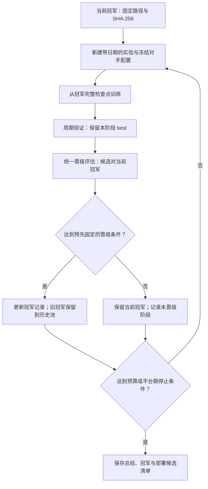

# 历史对手池、冠军晋级与自动训练监控

2026-10-31，按用户要求记录。目标是由 agent 在已授权预算内持续组织训练、监控、评估和版本留存，
每阶段从当前冠军继续学习，混入以前的冻结模型；通过评估的新冠军进入下一阶段。
停止表示当前方案在既定预算内没有可靠提升，不表示已经证明达到最优策略。

## 职责放在哪里

| 层 | 位置 | 职责 |
| --- | --- | --- |
| 仓库约定 | `AGENTS.md` | 告诉每个协作者版本、评估、模型与记录规则 |
| 训练方法 | 本文 | 定义历史池、晋级、监控、失败处理和停止条件 |
| RSI 总控角色 | `.codex/agents/orchestrator.toml` | gpt-6.1-sol / high；统筹诊断、方案、实施验证、训练评估、版本留存和迭代决策 |
| Codex 监控角色 | `.codex/agents/training-monitor.toml` | gpt-6.1-terra / medium；每 180 秒巡检并向父任务汇报 |
| 持久执行 | 每个实验的 `run.py`、训练和评估进程 | 在 agent 暂时不运行时仍执行确定的训练与后处理 |
| 定时检查 | 定时任务／外部调度器 | 唤醒监控或总控 agent，检查状态并处理需要关注的变化 |
| 状态账本 | 运行实例的状态、阶段记录、冠军清单 | 断点恢复、幂等和跨会话接续 |

OpenAI 官方文档支持在项目 `.codex/agents/` 放独立 TOML 自定义 agent，
基本字段为 `name`、`description`、`developer_instructions`；它继承父会话权限。
角色定义与定时调度是不同能力，文件不会自行启动持续监控。
见 [自定义 agent](https://learn.chatgpt.com/docs/agent-configuration/subagents)。

本地项目的定时任务需要机器和桌面应用保持运行；可在原聊天中按分钟检查长任务。
监控任务应在状态未变化时保持安静，只报告完成、失败、恢复、晋级或需要处理的异常。
见 [定时任务](https://learn.chatgpt.com/docs/automations?surface=app)。

项目角色已安装到 `.codex/agents/`，可安装副本保存在 `configs/agents/`。
主 agent 通过 subagent 工具调用并提供同一运行实例、已有授权、预算和停止条件；
总控独占训练控制，监控通过父任务报告异常，无需新建独立 chat。
`orchestrator` 负责完整 RSI 链路，本文规定其中的训练、评估与晋级部分；
改进假设、实施与正确性检查也由总控组织，每轮记录证据并在任务预算内决定继续或停止。
详见 [角色与调用说明](../configs/agents/README.md)。
`configs/training-loop.draft.json` 是未启用的流程草案，不是已有可执行循环入口。

## 一轮完整流程

每轮起点是当前已晋级冠军，不是上一轮最后一次更新，也不必是版本号最大者。
候选先通过本阶段验证选 best，随后才能参加晋级评估；阶段 best 可能仍是 step=0 的冠军原权重。
这种情况没有产生新冠军，不能仅因完成训练就将版本升级为“更强”。

用户指定固定阵容的有限版本序列时，按该轮协议衔接阶段。
版本列表或起止范围、首阶段来源、各阶段预算每次指定，不固定编号或阶段数。
首阶段使用明确锁定的 best 完整检查点，后续阶段继承前一阶段 best；
例如指定 V7→V8，V8 使用 V7 best，不按编号推断首阶段来源，也不自动追加范围外版本。
阶段起点 step=0 也参与选模，未改善则继承起点；来源为 best 对应的完整 PPO/Adam 检查点。
总预算按各阶段合计，最后一个指定阶段及最终评估完成后停止；预算或停止条件先到则提前结束。
这不等于自动更新全局冠军或采用草案中的历史池比例；本轮明确协议优先。

## 历史对手池

2026-11-01 用户新增版本废弃规则：最终选定 best 的策略与继承来源相同，则不作为新策略版本。
在 `configs/model-versions.json` 登记 `retired` 并指向有效原版；目前 V4→V3、V6→V5，V7直接从V5继承。
应核验策略张量指纹及完整Adam，记录所选PPO轮和实际训练样本；ZIP元数据不同不代表策略更新，
废弃也不代表阶段没训练。保留旧权重、配置与日志，避免破坏历史引用。
新实例的候选、开发参考池和训练对手池排除这些废弃版本；生命周期清单和排除名单随排名输入封存，
不通过修改全局清单追溯改变已封存的历史排名或实验。

2026-11-01 最新用户约定覆盖下列早先比例建议：后续阵容使用统一开发评估中最强的三个历史 bot，
每版两个席位，加一个脚本；学习者另算第八席。不要求所有旧版保留，不保护最新版本必入池。
原生脚本命名为 V0，前三名额仅包含 V1 起的训练版本；新报告使用 V0，旧 scripted 标识保持兼容。
各候选在同一参考混合池、开发种子、随机模式和局数下比较平均名次，独立 test 不参与选池，
不同训练阵容下的历史 val 也不能直接排名。未入当期池不删除权重，可在后续重新评估。
每次实验预先锁定参考池、候选范围、种子、局数、同分规则与评估预算；对手排名不改变学习者的续训来源。

- 一局仍是 1 个学习者 + 7 个对手。对手模型全部冻结，采样都不保留梯度；只更新学习者。
- 保留当前冠军和多个较早冠军的版本、路径、SHA-256、精度和来源实验。
- 每阶段开始时确定对手分配并冻结整阶段配置，不在训练过程中改正在加载的对手权重文件。
- 可将更多席位分配给较新的冠军，同时保留旧冠军和少量脚本，避免只适应最近一个对手。
- 示例：3 个当前冠军 + 2 个历史冠军席位 + 2 个脚本，共 7 个对手。比例是建议，不是 V4 已确定的新配置。
- 当前通用 `opponent_pool` 已支持多个固定版本及数量；逐局动态抽取任意历史版本的调度尚未实现。
- “每代只留自己的 best”与“保留历代冠军”同时成立：不能删除仍被历史池引用的旧冠军文件。

历史模型加入后对局可能更难，但实力不保证逐代单调增加：不同策略可能互相克制。
因此既要测新旧冠军的直接表现，也要在固定参考对手上复核，不能只靠版本号或训练完成判断晋级。

## 三种评估不能混为一谈

| 评估 | 用途 | 规则 |
| --- | --- | --- |
| 阶段内 val | 从本轮多个检查点选阶段 best | 同一冻结对手、种子、采样模式；仍以混合随机组平均名次严格降低选 best |
| 晋级评估 | 决定是否替换当前冠军 | 候选与冠军使用统一协议；固定参考池和预先锁定的晋级种子；属于开发评估 |
| 独立 test | 报告最终泛化结果 | 不参与检查点选择或冠军晋级；不能训练使用测试局面或标签 |

训练对手随代更新后，不能直接拿不同阵容下的 `val/mean_placement` 比较跨代实力。
固定参考池也不需要额外七脚本验证，继续遵循混合随机／贪心两组设置。
各表必须写明对手版本／数量、学习者随机或贪心、精度、局数及配置摘要。

建议的晋级确认局可使用 2 脚本 + 1 固定 V1 + 1 固定 V2 + 2 当前冠军 + 2 候选，
共 8 席；冠军与候选同场、席位轮换。该阵容是草案，应在本次自动循环开始前锁定。
以整局为单位计算平均名次差及 bootstrap 区间，不能把同局的多个席位当独立样本。

草案建议：先固定 256 局筛查，再对所有达到预定筛查条件的候选统一做 1,024 局确认，
两阶段种子预先锁定，不随结果挑选更多有利测试。
晋级主指标仍是平均名次，建议要求候选改善至少 0.1 名，且确认评估的 95% 名次差区间上界小于 0。
这些数值尚未启用；本轮 V3 不回溯应用。

同时报告吃鸡率、前四率、循环、触顶和动作数。若部署使用 Greedy，应预先定义其退化容忍范围；
随机组变强不保证 Greedy 同样变强。候选与冠军的行为指标必须用同一检测模式重新计算，
不能直接比较旧 `reversible_segment` 与新 `all_actions` 的原始循环计数。

## 监控与恢复

主 agent 调用 `orchestrator` 总控 RSI 链路，进入需持续监控的训练阶段时，
拉起或复用 `training_monitor` subagent；纯诊断或实施阶段不要求常驻训练监控。
不要求为每个采样器配置一个 Codex agent。总控负责控制训练，监控每 3 分钟巡检。
监控立即执行首次检查，此后以单调时钟每 180 秒检查，单次等待不超过 60 秒。
监控依赖活跃 subagent，退出或中断后不能声称继续运行；主 agent 关注子任务状态。
需要跨回合持久唤醒时另行接通真实调度器，不能把角色文件或活跃等待当成已注册调度。

每次检查至少查看：

1. PID 与阶段、进度更新时间、PPO／Adam／样本数是否推进。
2. CPU／GPU 利用率、显存、采样和更新耗时；评估阶段使用单独的耗时预期。
3. NaN／Inf、原生动作拒绝、无真实名次终止、异常堆栈及中断信号。
4. LR 与 scheduler、Adam 继承、权重和对手摘要是否与本轮配置一致。
5. W&B 与本地 journal 是否连续、验证点和 best 是否对应正确版本。

不能仅因评估阶段没有 PPO 增长就判定卡死；结合 PID、日志、GPU 活动和该阶段耗时判断。
同一实例只允许一个 orchestrator 推进阶段，先检查存活进程和实例锁，防止重复训练或并行抢占同一 GPU。

明确为意外中断且仍在已授权范围内时，从最近完整 PPO 检查点恢复，保留 Adam、LR 进度、
原参数与原 W&B run。丢弃未完成 rollout；未保存的环境和 RNG 需要重建，不宣称轨迹逐位重放。
先封存中断现场，再记录恢复来源及配置摘要；未知异常先诊断，限制重试次数，避免重启死循环。
用户明确停止的训练不得自动恢复。训练参数、奖励和对手的调整放入下一实验。

## 冠军、留存与停止

冠军记录至少保存版本、模型路径、SHA-256、来源实验、选中检查点、晋级依据和上一冠军。
更新本地冠军清单与在外部服务部署是不同操作；未获得对应部署授权时只准备模型包及部署清单。
实际部署应匹配已评估的选动作方式和精度。

建议将“没有提升”定义为连续 3 个完整阶段未晋级，或达到预先规定的总阶段数、GPU 时间／样本预算。
预算与停止数值在自动循环启用前记录；不能创建没有资源上限的无限训练循环。
停止时保留冠军和历史池引用的权重、所有配置与结果；写明是平台期、预算耗尽还是运行故障。

## 当前落地状态

- 已有：多版本冻结对手、PPO 训练、周期 val、本阶段 best、原 W&B 接续、完整检查点恢复、独立评估与阶段留存。
- 本次新增：RSI 全链路总控 orchestrator、训练监控角色及主 agent 的 subagent 调用约定；可安装副本保存在 `configs/agents/`。
- 尚未接通：定时唤醒、跨阶段状态机、实例锁、自动晋级／冠军清单更新，以及无人工跟进的跨代循环。
- 安装角色不会启动训练、注册持久定时任务或自动部署；实际训练状态以各实验记录为准。

相关入口：[V4 准备版](../experiments/20261031-exp04-v4-cycle-only/README.md)、
[指标与选模](TRAINING_METRICS.md)、[实验版本索引](../experiments/README.md)。
