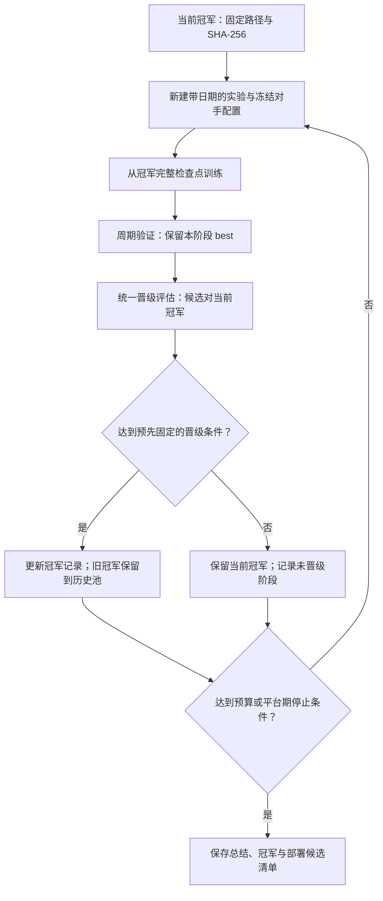

# 历史对手池、冠军晋级与自动训练监控

2026-10-31，按用户要求记录。目标是由 agent 在已授权预算内持续组织训练、监控、评估和版本留存，
每阶段从当前冠军继续学习，混入以前的冻结模型；通过评估的新冠军进入下一阶段。
停止表示当前方案在既定预算内没有可靠提升，不表示已经证明达到最优策略。

## 职责放在哪里

| 层 | 位置 | 职责 |
| --- | --- | --- |
| 仓库约定 | `AGENTS.md` | 告诉每个协作者版本、评估、模型与记录规则 |
| 训练方法 | 本文 | 定义历史池、晋级、监控、失败处理和停止条件 |
| Codex 协调角色 | `.codex/agents/training-coordinator.toml` | 读取证据、协调阶段、诊断异常、解释晋级结果 |
| 持久执行 | 每个实验的 `run.py`、训练和评估进程 | 在 agent 暂时不运行时仍执行确定的训练与后处理 |
| 定时检查 | 定时任务／外部调度器 | 唤醒协调 agent，检查状态并处理需要关注的变化 |
| 状态账本 | 运行实例的状态、阶段记录、冠军清单 | 断点恢复、幂等和跨会话接续 |

OpenAI 官方文档支持在项目 `.codex/agents/` 放独立 TOML 自定义 agent，
基本字段为 `name`、`description`、`developer_instructions`；它继承父会话权限。
角色定义与定时调度是不同能力，文件不会自行启动持续监控。
见 [自定义 agent](https://learn.chatgpt.com/docs/agent-configuration/subagents)。

本地项目的定时任务需要机器和桌面应用保持运行；可在原聊天中按分钟检查长任务。
监控任务应在状态未变化时保持安静，只报告完成、失败、恢复、晋级或需要处理的异常。
见 [定时任务](https://learn.chatgpt.com/docs/automations?surface=app)。

当前项目 `.codex/` 为只读挂载；可安装的角色草案先保存在
`configs/agents/training-coordinator.toml`，尚未注册为已运行的角色。
`configs/training-loop.draft.json` 是未启用的流程草案，不是已有可执行循环入口。

## 一轮完整流程

每轮起点是当前已晋级冠军，不是上一轮最后一次更新，也不必是版本号最大者。
候选先通过本阶段验证选 best，随后才能参加晋级评估；阶段 best 可能仍是 step=0 的冠军原权重。
这种情况没有产生新冠军，不能仅因完成训练就将版本升级为“更强”。

## 历史对手池

- 一局仍是 1 个学习者 + 7 个对手。对手模型全部冻结，采样都不保留梯度；只更新学习者。
- 保留当前冠军和多个较早冠军的版本、路径、SHA-256、精度和来源实验。
- 每阶段开始时确定对手分配并冻结整阶段配置，不在训练过程中改正在加载的对手权重文件。
- 可将更多席位分配给较新的冠军，同时保留旧冠军和少量脚本，避免只适应最近一个对手。
- 示例：3 个当前冠军 + 2 个历史冠军席位 + 2 个脚本，共 7 个对手。比例是建议，不是 V4 已确定的新配置。
- 当前通用 `opponent_pool` 已支持多个固定版本及数量；逐局动态抽取任意历史版本的调度尚未实现。
- “每代只留自己的 best”与“保留历代冠军”同时成立：不能删除仍被历史池引用的旧冠军文件。

历史模型加入后对局可能更难，但实力不保证逐代单调增加：不同策略可能互相克制。
因此既要测新旧冠军的直接表现，也要在固定参考对手上复核，不能只靠版本号或训练完成判断晋级。

## 三种评估不能混为一谈

| 评估 | 用途 | 规则 |
| --- | --- | --- |
| 阶段内 val | 从本轮多个检查点选阶段 best | 同一冻结对手、种子、采样模式；仍以混合随机组平均名次严格降低选 best |
| 晋级评估 | 决定是否替换当前冠军 | 候选与冠军使用统一协议；固定参考池和预先锁定的晋级种子；属于开发评估 |
| 独立 test | 报告最终泛化结果 | 不参与检查点选择或冠军晋级；不能训练使用测试局面或标签 |

训练对手随代更新后，不能直接拿不同阵容下的 `val/mean_placement` 比较跨代实力。
固定参考池也不需要额外七脚本验证，继续遵循混合随机／贪心两组设置。
各表必须写明对手版本／数量、学习者随机或贪心、精度、局数及配置摘要。

建议的晋级确认局可使用 2 脚本 + 1 固定 V1 + 1 固定 V2 + 2 当前冠军 + 2 候选，
共 8 席；冠军与候选同场、席位轮换。该阵容是草案，应在本次自动循环开始前锁定。
以整局为单位计算平均名次差及 bootstrap 区间，不能把同局的多个席位当独立样本。

草案建议：先固定 256 局筛查，再对所有达到预定筛查条件的候选统一做 1,024 局确认，
两阶段种子预先锁定，不随结果挑选更多有利测试。
晋级主指标仍是平均名次，建议要求候选改善至少 0.1 名，且确认评估的 95% 名次差区间上界小于 0。
这些数值尚未启用；本轮 V3 不回溯应用。

同时报告吃鸡率、前四率、循环、触顶和动作数。若部署使用 Greedy，应预先定义其退化容忍范围；
随机组变强不保证 Greedy 同样变强。候选与冠军的行为指标必须用同一检测模式重新计算，
不能直接比较旧 `reversible_segment` 与新 `all_actions` 的原始循环计数。

## 监控与恢复

一次启用可由一个 `training_coordinator` 统筹，不要求为每个采样器配置一个 Codex agent。
建议后台监督进程持续运行，agent 每 5 分钟检查一次；频率是草案。

每次检查至少查看：

1. PID 与阶段、进度更新时间、PPO／Adam／样本数是否推进。
2. CPU／GPU 利用率、显存、采样和更新耗时；评估阶段使用单独的耗时预期。
3. NaN／Inf、原生动作拒绝、无真实名次终止、异常堆栈及中断信号。
4. LR 与 scheduler、Adam 继承、权重和对手摘要是否与本轮配置一致。
5. W&B 与本地 journal 是否连续、验证点和 best 是否对应正确版本。

不能仅因评估阶段没有 PPO 增长就判定卡死；结合 PID、日志、GPU 活动和该阶段耗时判断。
同一实例只允许一个协调者推进阶段，先检查存活进程和实例锁，防止重复训练或并行抢占同一 GPU。

明确为意外中断且仍在已授权范围内时，从最近完整 PPO 检查点恢复，保留 Adam、LR 进度、
原参数与原 W&B run。丢弃未完成 rollout；未保存的环境和 RNG 需要重建，不宣称轨迹逐位重放。
先封存中断现场，再记录恢复来源及配置摘要；未知异常先诊断，限制重试次数，避免重启死循环。
用户明确停止的训练不得自动恢复。训练参数、奖励和对手的调整放入下一实验。

## 冠军、留存与停止

冠军记录至少保存版本、模型路径、SHA-256、来源实验、选中检查点、晋级依据和上一冠军。
更新本地冠军清单与在外部服务部署是不同操作；未获得对应部署授权时只准备模型包及部署清单。
实际部署应匹配已评估的选动作方式和精度。

建议将“没有提升”定义为连续 3 个完整阶段未晋级，或达到预先规定的总阶段数、GPU 时间／样本预算。
预算与停止数值在自动循环启用前记录；不能创建没有资源上限的无限训练循环。
停止时保留冠军和历史池引用的权重、所有配置与结果；写明是平台期、预算耗尽还是运行故障。

## 当前落地状态

- 已有：多版本冻结对手、PPO 训练、周期 val、本阶段 best、原 W&B 接续、完整检查点恢复、独立评估与阶段留存。
- 本次新增：方法文档、协调角色 TOML 草案、未启用的循环策略草案。
- 尚未接通：定时唤醒、跨阶段状态机、实例锁、自动晋级／冠军清单更新，以及无人工跟进的跨代循环。
- V4 仍是 prepared；没有因本文件或 agent 草案启动训练、注册定时任务或自动部署。

相关入口：[V4 准备版](../experiments/20261031-exp04-v4-cycle-only/README.md)、
[指标与选模](TRAINING_METRICS.md)、[实验版本索引](../experiments/README.md)。
